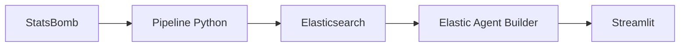

# Copa Scout | Underdog Scout

  

**Inteligência esportiva, análise de dados e IA**

## Sobre o projeto

Durante a Hack Night Rio — Copa do Mundo Edition, em 29 de maio de 2026, na ESPM Rio, idealizei a proposta **Underdog Scout: o DNA da zebra na Copa 2026**. A questão central era compreender como seleções menos favoritas conseguem resistir a adversários mais fortes.

Como graduanda em Sistemas de Informação pela UFF, participei da concepção da solução e da construção colaborativa da interface. Em cerca de quatro horas, a equipe integrou dados esportivos, Python, Elasticsearch, Elastic Agent Builder e Streamlit.

## Minhas contribuições

- Idealização da proposta e definição da problemática.
- Concepção inicial do Índice de Sobrevivência.
- Seleção das campanhas de Marrocos, Japão e Arábia Saudita em 2022 como referências.
- Desenvolvimento colaborativo da interface Streamlit com Alexandre Braga.
- Apresentação visual dos resultados e colaboração na entrega coletiva.

[Repositório original](https://github.com/jotave-br/copa-scout)

## Arquitetura pretendida na hackathon

## A experiência na hackathon

| Aspecto | Entrega coletiva |
|---|---|
| Data | 29 de maio de 2026 |
| Tempo | Cerca de 4 horas |
| Foco | Scout de zebras e resistência defensiva |
| Arquitetura | Pipeline → Elastic → agente → Streamlit |
| Resultado | Dados integrados e interface básica |

O evento foi organizado pela Elastic Community Rio de Janeiro, com ACE Laboratory e ESPM Rio. [Repositório do evento](https://github.com/salgado/hacknight-copa-2026).

- **Nathany Vargas:** idealização, concepção inicial do indicador e interface Streamlit.
- **Alexandre Braga:** desenvolvimento colaborativo da interface.
- **João Gabriel de Oliveira:** ambiente Elastic e ajustes no Agent Builder.
- **jotave-br:** pipeline Python, métricas e integração.

O escopo cresceu para 128 partidas das Copas de 2018 e 2022. A interface externa ficou básica e a equipe identificou que a avaliação esperava a apresentação dentro do Kibana. O frontend Streamlit não está entre os arquivos recuperados. A versão original preserva problemas conhecidos de configuração e contagem de disputas de pênaltis.

## Índice de Sobrevivência

A proposta inicial do indicador busca sintetizar ações defensivas e situações de vulnerabilidade para investigar a resistência de seleções menos favoritas. Trata-se de uma métrica exploratória, não de uma probabilidade de vitória.

## Estrutura e disponibilidade

O [código da entrega coletiva](copa_scout_original/) contém o pipeline Python, os dados processados, o cache de eventos e os scripts de configuração do agente. O ambiente de demonstração expirou e o frontend Streamlit não está entre os arquivos recuperados. Não há demonstração online ativa.

## Aprendizados e competências

A experiência envolveu concepção de produtos orientados a dados, formulação de problemas, definição de indicadores, visualização de informações, desenvolvimento colaborativo de interfaces e trabalho sob restrições de tempo. O projeto evidencia a importância de alinhar requisitos, critérios de avaliação e apresentação dos resultados.

## Possibilidades de evolução

- Reconstrução da interface Streamlit.
- Validação estatística dos pesos do indicador.
- Ampliação da base esportiva e exploração de padrões táticos.
- Aprimoramento da experiência de visualização.

São propostas futuras, não funcionalidades implementadas.

## Créditos e referências

- [Repositório de origem — jotave-br](https://github.com/jotave-br/copa-scout).
- Equipe original: Nathany Vargas, Alexandre Braga, João Gabriel de Oliveira e jotave-br.
- [StatsBomb Open Data](https://github.com/statsbomb/open-data).
- [Hack Night Rio](https://github.com/salgado/hacknight-copa-2026).
- [Elastic](https://www.elastic.co/) e [Streamlit](https://streamlit.io/).

## Sobre mim

**Nathany Vargas** — graduanda em Sistemas de Informação pela UFF, com interesse em inteligência artificial, análise de dados e desenvolvimento tecnológico.

[Meu perfil no GitHub](https://github.com/nathany-vargas)
