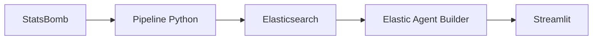

# Copa Scout | Underdog Scout

  

**Inteligência esportiva, análise de dados e IA**

## Sobre o projeto

Durante a Hack Night Rio — Copa do Mundo Edition, em 29 de maio de 2026, na ESPM Rio, idealizei a proposta **Underdog Scout: o DNA da zebra na Copa 2026**. A questão central era compreender como seleções menos favoritas conseguem resistir a adversários mais fortes.

Como graduanda em Sistemas de Informação pela UFF, participei da concepção da solução e da construção colaborativa da interface. Em cerca de quatro horas, a equipe integrou dados esportivos, Python, Elasticsearch, Elastic Agent Builder e Streamlit.

## Minhas contribuições

- Idealização da proposta e definição da problemática.
- Concepção inicial do Índice de Sobrevivência.
- Seleção das campanhas de Marrocos, Japão e Arábia Saudita em 2022 como referências.
- Desenvolvimento colaborativo da interface Streamlit com Alexandre Braga.
- Apresentação visual dos resultados e colaboração na entrega coletiva.

Este fork preserva a entrega coletiva e a revisão posterior, realizada individualmente por [jotave-br](https://github.com/jotave-br). A revisão não é de minha autoria.

[Repositório original](https://github.com/jotave-br/copa-scout)

## Arquitetura pretendida na hackathon



O deployment de demonstração era um trial e expirou. Ficaram o código, os dados processados e duas especificações Vega recuperadas. Não há demonstração online ativa nem um export completo do dashboard.

Quem tiver interesse em explorar a implementação pode configurar um novo ambiente no Elastic Cloud com Kibana e Agent Builder, inclusive usando um [trial, conforme as condições da Elastic](https://www.elastic.co/cloud/cloud-trial-overview). O caminho é preencher as URLs e a chave de API no `.env` da versão de revisão, executar o pipeline para carregar os dados e, por último, rodar `4_agent_setup.py` para cadastrar as ferramentas de consulta e configurar o agente `copa-scout`. O ambiente também precisa ter um modelo de linguagem disponível para o Agent Builder. As duas especificações Vega são carregadas separadamente no Kibana, conforme o [guia de execução](copa_scout_review/README.md) e o [guia do dashboard](copa_scout_review/dashboard/README.md).

Esses arquivos permitem reconstruir as duas visualizações personalizadas e investigar como os dados alimentam as análises. Para remontar o dashboard completo, os outros três painéis precisam ser criados manualmente a partir da configuração documentada. O autor da revisão não refez o ambiente após o fim do trial, então esse processo pode exigir ajustes de compatibilidade; preservei o material para que a implementação possa ser estudada e reconstruída por quem tiver interesse.

## Duas versões, um aprendizado

| | Hackathon | Revisão solo |
|---|---|---|
| Pasta | [`copa_scout_original/`](copa_scout_original/) | [`copa_scout_review/`](copa_scout_review/) |
| Quando | 29 de maio de 2026 | Dia seguinte ao evento |
| Tempo de trabalho | Cerca de 4 horas em equipe | Mais 4 horas, sozinho |
| Foco | Scout de zebras com interface externa | Análise contrafactual dentro do Kibana |
| Arquitetura pretendida | Pipeline → Elastic → agent → Streamlit | Pipeline → Elastic → agent e dashboard no Kibana |
| Resultado | Dados integrados e UI básica; apresentação pouco alinhada ao uso esperado do Kibana | Agent, análise contrafactual e dashboard concentrados no Kibana |

### A hackathon

O evento foi organizado pela Elastic Community Rio de Janeiro, com ACE Laboratory e ESPM Rio. [Repositório do evento](https://github.com/salgado/hacknight-copa-2026).

- **Nathany Vargas:** idealização, concepção inicial do indicador e interface Streamlit.
- **Alexandre Braga:** desenvolvimento colaborativo da interface.
- **João Gabriel de Oliveira:** ambiente Elastic e ajustes no Agent Builder.
- **jotave-br:** pipeline Python, métricas e integração.

O escopo cresceu para 128 partidas das Copas de 2018 e 2022. A interface externa ficou básica e a equipe identificou que a avaliação esperava a apresentação dentro do Kibana. O frontend Streamlit não está entre os arquivos recuperados. A versão original preserva problemas conhecidos de configuração e contagem de disputas de pênaltis.

### Revisão posterior

No dia seguinte, jotave-br retomou individualmente o projeto por mais quatro horas, concentrando a integração no Kibana e acrescentando análises contrafactuais e visualizações Vega e Vega-Lite, com apoio do Claude Opus. A documentação técnica a seguir descreve essa revisão, cuja autoria permanece preservada.

## O que está preservado

```text
Copa Scout/
├── README.md
├── copa_scout_original/
│   ├── 1_extract.py ... 6_advanced_analysis.py
│   ├── config.py
│   ├── fix_agent.py
│   ├── cache/
│   └── *.csv
└── copa_scout_review/
    ├── README.md
    ├── config.py
    ├── .env.example
    ├── requirements.txt
    ├── 1_extract.py ... 7_contrafactual.py
    ├── *.csv
    ├── tests/
    └── dashboard/
        ├── README.md
        └── vega/
            ├── scatter_xg.json
            └── heatmap_zonas_perda.json
```

A versão original serve como registro do trabalho no evento. A pasta da revisão inclui correções posteriores feitas ao organizar este repositório; seus CSVs refletem essas correções, não um retrato exato dos índices do trial.

## Como a revisão funciona

```text
StatsBomb → cache local → métricas e CSVs → Elasticsearch
                                              ├── Agent Builder: perguntas e tools ES|QL
                                              └── Kibana: dashboard Lens + Vega
```

### Análise contrafactual

Este foi nosso primeiro contato, ainda básico e exploratório, com perguntas contrafactuais: tentar compreender o que poderia ter acontecido se um evento tivesse sido diferente. Na revisão individual, o autor ampliou essa ideia. A implementação usa frequências observadas em situações semelhantes como referência para discutir possibilidades; não estima, por si só, o efeito causal de mudar uma jogada.

O [`7_contrafactual.py`](copa_scout_review/7_contrafactual.py) registra perdas (`Dispossessed`, `Miscontrol`, `Error`) e recuperações (`Ball Recovery`, `Interception`). Cada evento recebe uma zona pela coordenada x da StatsBomb:

| Zona | Coordenada x |
|---|---|
| `own_third` | x < 40 |
| `mid_third` | 40 ≤ x < 80 |
| `final_third` | x ≥ 80 |

O script observa os eventos posteriores nos **30 segundos seguintes, dentro do mesmo período**. Para uma perda, procura finalizações do adversário; para uma recuperação, finalizações do próprio time. Registra `goal`, `shot` ou `nothing` e o xG gerado.

Depois agrupa por zona, tipo de evento e perspectiva. Cada registro recebe o tamanho do grupo e as frequências de chute, gol e ausência de chute. `pct_resulted_shot` inclui os chutes que terminaram em gol; não deve ser somado a `pct_resulted_goal` como se fossem resultados exclusivos.

A resposta pretendida é: “Em X situações similares nas Copas 2018/2022, Y% resultaram em chute e Z% em gol.” Isso descreve o histórico de situações agrupadas; não calcula o resultado de uma partida alternativa.

### Índice de Sobrevivência

É uma métrica exploratória com pesos definidos à mão:

| Componente | Peso |
|---|---:|
| Bloqueios | +2,5 |
| Interceptações e desarmes | +2,0 cada |
| Recuperações de bola | +1,5 |
| Pressões e cortes | +1,0 cada |
| Chutes no gol sofridos | −3 |
| Gols sofridos | −10 |

O valor bruto é ajustado por `IS × 90 / minutos_jogados`. Uma normalização min-max coloca os 256 registros de time por partida na escala de 0 a 100. Na base atual, o mínimo é a Suíça contra Portugal em 2022.

| Faixa final | Classificação |
|---|---|
| IS > 85 | Fortaleza Impenetrável |
| 65 < IS ≤ 85 | Muro Sólido |
| 40 < IS ≤ 65 | Resistência Competitiva |
| 20 < IS ≤ 40 | Sobrevivência Precária |
| IS ≤ 20 | Defesa Colapsada |

Os campos `is_top_strength`, `is_second_strength`, `is_top_weakness` e `is_second_weakness` mostram as maiores contribuições positivas e negativas do cálculo bruto. São parcelas em pontos, não percentuais da escala final.

### Dados disponíveis

As contagens abaixo são dos CSVs locais corrigidos. Os scripts usam os mesmos nomes para os índices no Elasticsearch.

| Arquivo / índice | Um registro representa | Registros | Script |
|---|---|---:|---|
| `match_stats` | Um time em uma partida | 256 | 2 e 3 |
| `team_profiles` | Uma seleção em um torneio | 64 | 2 e 3 |
| `goal_chains` | Um chute convertido em gol e sua cadeia de eventos | 326 | 5 |
| `turnovers` | Uma perda de bola e o perigo nos 15 eventos seguintes do período | 5.975 | 6 |
| `player_impact` | Um jogador em uma partida, após o filtro mínimo de atividade | 3.670 | 6 |
| `match_momentum` | Um time em um intervalo de até 15 minutos | 1.832 | 6 |
| `counterfactual_events` | Uma perda ou recuperação e seus desdobramentos em 30 segundos | 20.121 | 7 |

### Agent e dashboard

Usamos o **Elastic Agent Builder para configurar um agente personalizado**, o `copa-scout`. A plataforma fornece a infraestrutura de conversação e de execução das ferramentas. Nossa implementação prepara os dados e define as instruções do agente, as consultas disponíveis e os parâmetros que ele pode preencher para buscar informações no Elasticsearch. Não houve treinamento de um modelo próprio.

Na versão de revisão, o [`4_agent_setup.py`](copa_scout_review/4_agent_setup.py) registra, pela API do Kibana, **10 ferramentas de consulta ES|QL** e cria ou atualiza o agente, associando essas ferramentas às suas instruções. Por exemplo, uma pergunta sobre o Brasil pode acionar uma consulta com `team = Brazil`; os resultados retornados servem de contexto para a resposta. Esse é o papel das tools descritas abaixo:

| Tool | Uso |
|---|---|
| `counterfactual` | Frequências históricas por zona e tipo de evento |
| `goal-chain-analysis` | Sequência de eventos associada aos gols sofridos |
| `turnover-analysis` | Perdas de bola e nível de perigo |
| `player-impact` | Impacto de jogadores por partida |
| `match-momentum` | Evolução das métricas ao longo do jogo |
| `team-match-stats` | Métricas da seleção em cada partida |
| `match-comparison` | Comparação dos dois times de uma partida |
| `team-profile` | Perfil agregado por seleção e torneio |
| `ranking-defensivo` | Ranking do Índice de Sobrevivência médio |
| `confronto-direto` | Partidas entre duas seleções |

O prompt orienta o agent a consultar as tools, responder em português e usar linguagem cautelosa. As queries completas estão no código.

O dashboard reunia ranking defensivo, comparativo entre times, diagnóstico em tabela, dispersão de xG e mapa de eventos no campo. Agent e dashboard eram usados em abas separadas; este código não implementa controle do dashboard pelo agent.

As duas specs recuperadas e as instruções para reconstruir as visualizações estão no [guia do dashboard](copa_scout_review/dashboard/README.md). As visualizações Lens não foram exportadas, e não há screenshots do deployment original.

## Executar ou explorar

Para conhecer o projeto, é possível ler os CSVs, o código e as specs sem uma conta Elastic. Para executar a integração, é necessário um novo deployment com Agent Builder e credenciais próprias.

O [guia da revisão](copa_scout_review/README.md) contém instalação, configuração por `.env`, ordem dos scripts e testes locais. O `.env.example` tem apenas `chavinha_expirada`; não contém acesso a nenhum ambiente.

## Correções ao organizar o repositório

Alguns problemas só ficaram claros ao revisar os resultados. Os ajustes abaixo estão na versão de revisão, preservando o código original do evento:

- O filtro da disputa de pênaltis era sobrescrito em `count_threat()`. A correção também exclui essas cobranças das análises de gols, jogadores e momentum e do cálculo de duração. Brasil × Croácia de 2022 passa a ter 1 gol de cada time nas métricas.
- As perdas de bola passam a olhar os eventos em ordem cronológica e dentro do mesmo período. A análise contrafactual respeita essa sequência, inclusive para eventos no mesmo segundo.
- O momentum inclui eventos no minuto que coincide com o limite final do último intervalo.
- A narrativa textual de cada partida usa o mesmo índice e a mesma classificação final das colunas numéricas.
- Credenciais antigas foram substituídas por marcadores. A revisão usa variáveis de ambiente, com suporte a `.env`.

Os testes locais cobrem esses cálculos; não substituem a validação da integração em um novo Kibana. A spec do heatmap recebeu duas correções de renderização; essas correções e as limitações restantes estão descritas no guia do dashboard.

## Limitações

- Frequência condicional não demonstra causalidade. A definição de “similar” não considera placar, minuto, pressão ou qualidade dos jogadores.
- A janela contrafactual não verifica mudanças de posse entre o evento e a finalização. Alguns grupos têm poucos exemplos.
- Gols e cadeias são derivados de eventos `Shot` com resultado `Goal`; gols contra não entram nessas contagens. O placar dos metadados pode diferir da métrica de gols por finalização.
- Os pesos do Índice de Sobrevivência são arbitrários. A escala depende desta base, e o tempo jogado usa o maior minuto observado nos eventos, incluindo acréscimos.
- Posse de bola é uma aproximação pela proporção de passes. O ranking de impacto retorna registros por partida, não uma soma de toda a competição por jogador.
- `team_profiles` não contém `match_id`; seu ranking de torneio não deve ser interpretado como análise de uma partida selecionada.
- O heatmap recuperado mistura perdas e recuperações e busca até 5.000 documentos. A dispersão fixa a Copa 2022 e não incorpora o contexto dos controles do dashboard.
- Não há ambiente ativo para validar novamente as APIs, a importação das specs ou o comportamento dos controles.

## Aprendizados e competências

A experiência envolveu concepção de produtos orientados a dados, formulação de problemas, definição de indicadores, visualização de informações, desenvolvimento colaborativo de interfaces e trabalho sob restrições de tempo. O projeto evidencia a importância de alinhar requisitos, critérios de avaliação e apresentação dos resultados.

## Possibilidades de evolução

- Reconstrução da interface Streamlit.
- Validação estatística dos pesos do indicador.
- Ampliação da base esportiva e exploração de padrões táticos.
- Aprimoramento da experiência de visualização.

São propostas futuras, não funcionalidades implementadas.

## Créditos e referências

- [Repositório original e revisão individual — jotave-br](https://github.com/jotave-br/copa-scout).
- Equipe original: Nathany Vargas, Alexandre Braga, João Gabriel de Oliveira e jotave-br.
- [StatsBomb Open Data](https://github.com/statsbomb/open-data).
- [Hack Night Rio](https://github.com/salgado/hacknight-copa-2026).
- [Elastic](https://www.elastic.co/) e [Streamlit](https://streamlit.io/).
- Apoio de LLMs no pipeline e revisão: Claude (Anthropic), conforme documentação original.

## Sobre mim

**Nathany Vargas** — graduanda em Sistemas de Informação pela UFF, com interesse em inteligência artificial, análise de dados e desenvolvimento tecnológico.

[Meu perfil no GitHub](https://github.com/nathany-vargas)
